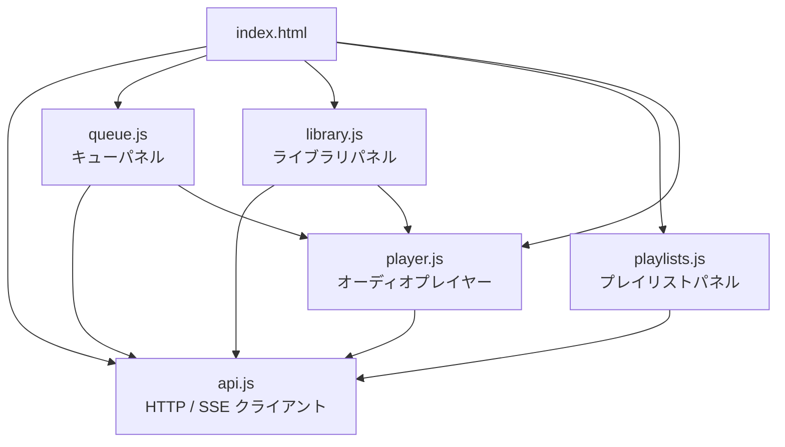
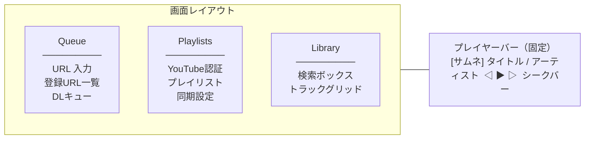

# フロントエンド概要

フレームワークなしの **バニラ JavaScript（ES6 モジュール）** と **プレーン CSS** で構築されています。

## プレイリスト更新の表示維持

`playlists.js` はプレイリストIDと同期IDごとにデータ・DOM要素を保持します。
同期追加・設定変更はAPIが返したレコードをそのカードへ反映し、YouTubeのアカウント一覧を再取得しません。
手動更新でも、同じIDのカードと操作ボタンを維持してメタデータだけを更新します。
トラックの展開、エラー詳細、フォーカス、スクロール位置を不要にリセットせず、取得失敗時も既存の一覧を残します。
遅い応答は要求番号で判定し、新しい取得や保存・削除の結果を古い応答で上書きしません。
アカウントを解除・変更する場合は、アカウント固有のキャッシュを破棄します。

Service WorkerのAPI通信失敗は503として返し、成功した空の一覧として扱いません。
UIの変更時はService Workerのシェルキャッシュのバージョンも更新し、旧スクリプトを残さないようにします。

実DOMによる操作テストは、リポジトリ直下で以下を実行します。ランタイムにフロントエンドのビルド工程は不要で、npm依存はテスト専用です。

```bash
npm ci --ignore-scripts
npm test
```

JSDOM上で本番モジュールを読み込み、同期追加・一時停止・再開、展開状態、遅い応答、取得失敗、保存・削除との競合、URL同期、公開範囲変更、イベントの重複登録を確認します。

## ディレクトリ構成

```
frontend/
├── index.html        # メイン UI（4画面の管理ワークスペース）
├── manifest.json     # PWA マニフェスト
├── sw.js             # Service Worker
├── css/
│   └── app.css       # レスポンシブ CSS
└── js/
    ├── api.js        # HTTP クライアント + SSE
    ├── queue.js      # キューパネル
    ├── library.js    # ライブラリパネル
    ├── playlists.js  # プレイリストパネル
    └── player.js     # オーディオプレイヤー
```

## モジュール依存関係



---

## UI レイアウト

### デスクトップ（3 カラム）



### モバイル

画面上部のタブバーで Queue / Playlists / Library を切り替えます。プレイヤーバーは常に下部に固定表示されます。

---

## API クライアント (`api.js`)

すべてのモジュールが `api.js` をインポートして使用します。

### `api` オブジェクト

```javascript
// URL 管理
api.addUrl(payload)              // POST /urls
api.listUrls()                   // GET  /urls
api.deleteUrl(id, deleteFiles)   // DELETE /urls/{id}

// キュー管理
api.listQueue(status)            // GET  /queue
api.cancelJob(id)                // DELETE /queue/{id}
api.retryJob(id)                 // POST /queue/{id}/retry

// トラック管理
api.listTracks(params)           // GET  /tracks
api.updateTrack(id, data)        // PATCH /tracks/{id}
api.deleteTrack(id, deleteFile)  // DELETE /tracks/{id}

// YouTube プレイリスト
api.youtubeAuthUrl()             // GET  /youtube/auth/url
api.youtubeAuthStatus()          // GET  /youtube/auth/status
api.youtubeListAccountPlaylists()// GET  /youtube/playlists
api.youtubeCreateSync(payload)   // POST /youtube/syncs
api.youtubeUpdateSync(id, data)  // PATCH /youtube/syncs/{id}
api.youtubeSyncNow(id)           // POST /youtube/syncs/{id}/run

// その他
api.syncthingStatus()            // GET  /syncthing/status
api.getSettings()                // GET  /settings
api.updateSettings(payload)      // PATCH /settings
```

### SSE キュー購読

```javascript
const es = subscribeQueueEvents((jobs) => {
  jobs.forEach(job => updateProgressUI(job));
});
// 購読停止: es.close();
```

API エラー時はレスポンスの `detail` フィールドから `Error` を throw します。

## 管理中心の画面構成

`navigation.js` が同期・ダウンロード・ファイル・設定を切り替えます。
ハッシュは `#sync`、`#downloads`、`#files`、`#settings`。初期画面は同期です。
非表示の画面は `hidden` で操作対象から外し、遷移時もDOMと展開状態を維持します。
同期の概要件数は保持した同期レコードから算出し、設定変更・追加・削除で更新します。
詳細パネルも同期IDごとに保持し、再取得で作り直しません。
`library.js` は試聴ボタンだけで再生を始め、`player.js` は起動時に曲やプレイヤー表示を復元しません。
PCはサイドナビゲーション、スマホは下部ナビゲーション。試聴欄は明示操作時だけ小さく表示します。

## 操作結果のフィードバック

ファイル削除に失敗した場合は一覧を再取得せず、対象行に理由と再試行ボタンを表示します。
処理中は削除・再試行を無効化し、成功後に一覧を更新します。
同期の実行・設定変更・削除の結果は一覧と詳細パネルの両方に保持し、詳細を開いている間はパネル内の表示を使います。
同期追加の成功はプレイリスト名付きの通知で示し、「追加した同期を見る」で対象行へスクロール・フォーカスできます。
URL追加・アカウントからの追加の両方に対応し、次の追加開始時には前の成功通知を消します。

同期プレイリストの行クリックは専用の詳細表示処理に委譲します。ボタン・リンク・入力・詳細パネルからのイベントと文字選択は除外し、既存の詳細ボタンによるキーボード操作も維持します。画面は背景との色差・細い境界線・一定の余白で項目のまとまりを示します。強い影を多用せず、詳細パネルの重なりには控えめな影を使います。


## 書体と表示階層

日本語は自己ホストの Noto Sans JP サブセットで表示します。フォントの出典・ライセンス・再生成手順は `frontend/fonts/README.md` を参照してください。
名前、補足情報、状態、操作を別の位置に揃え、短い状態ラベルには文字と色の両方を使います。
320px・390px・タブレット・PCの幅と、明暗両テーマでフォント読み込み・はみ出し・状態とボタンの重なりを確認します。
